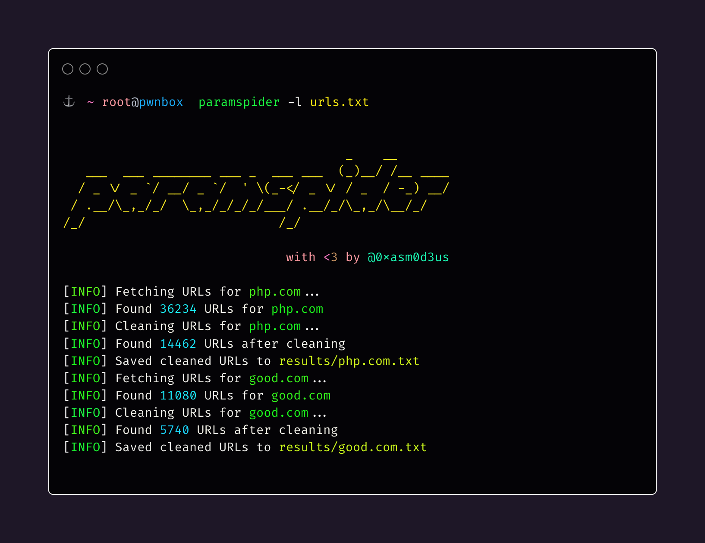

<h1 align="center">
    paramspider
  <br>
</h1>

<h4 align="center">  Mining URLs from dark corners of Web Archives for bug hunting/fuzzing/further probing </h4>

<p align="center">
  <a href="#about">📖 About</a> •
  <a href="#installation">🏗️ Installation</a> •
  <a href="#usage">⛏️ Usage</a> •
  <a href="#examples">🚀 Examples</a> •
  <a href="#contributing">🤝 Contributing</a> •
</p>




## About

`paramspider` allows you to fetch URLs related to any domain or a list of domains from Wayback achives. It filters out "boring" URLs, allowing you to focus on the ones that matter the most.

## Installation

To install `paramspider`, it is recommended to use a Python virtual environment to avoid conflicts with your system's packages (especially on Linux distributions enforcing **PEP 668**).

Follow these steps:

```sh
git clone https://github.com/devanshbatham/paramspider

cd paramspider

python3 -m venv venv

source venv/bin/activate

pip install .
```

**Note:** Whenever you want to run  paramspider  again in a new terminal session, remember to navigate to the folder and run  `source venv/bin/activate ` first.

## Usage

To use `paramspider`, follow these steps:

```sh
paramspider -d example.com
```

## Examples

Here are a few examples of how to use `paramspider`:

- Discover URLs for a single domain:

  ```sh
  paramspider -d example.com
  ```

- Discover URLs for multiple domains from a file:

  ```sh
  paramspider -l domains.txt
  ```

- Stream URLs on the termial:

    ```sh 
    paramspider -d example.com -s
    ```

- Set up web request proxy:

    ```sh
    paramspider -d example.com --proxy '127.0.0.1:7890'
    ```
- Adding a placeholder for URL parameter values (default: "FUZZ"): 

  ```sh
   paramspider -d example.com -p '"><h1>reflection</h1>'
  ```


## Star History

[](https://star-history.com/#devanshbatham/paramspider&Date)


